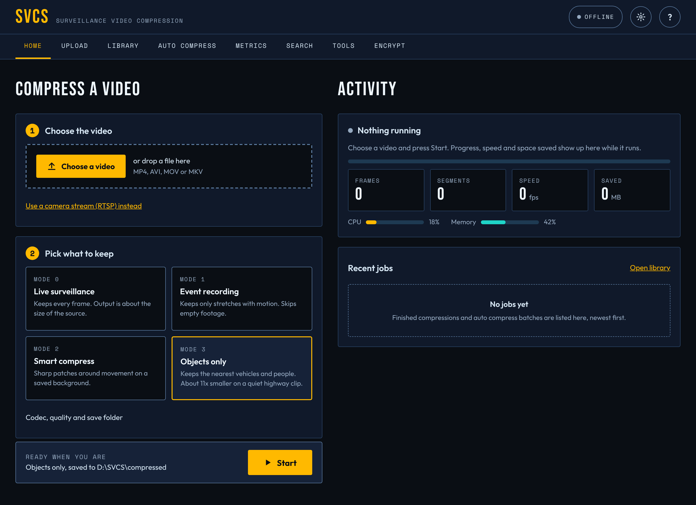
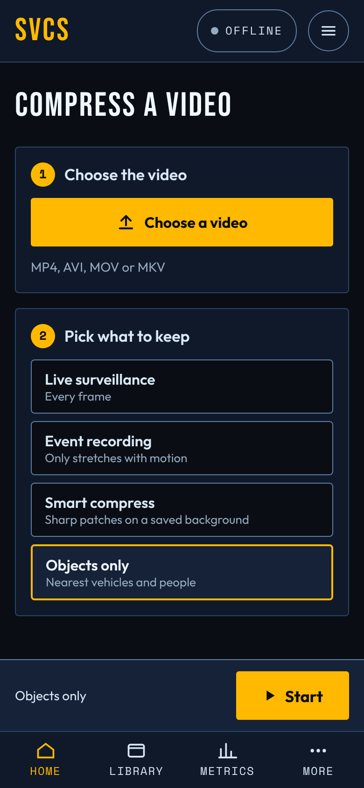
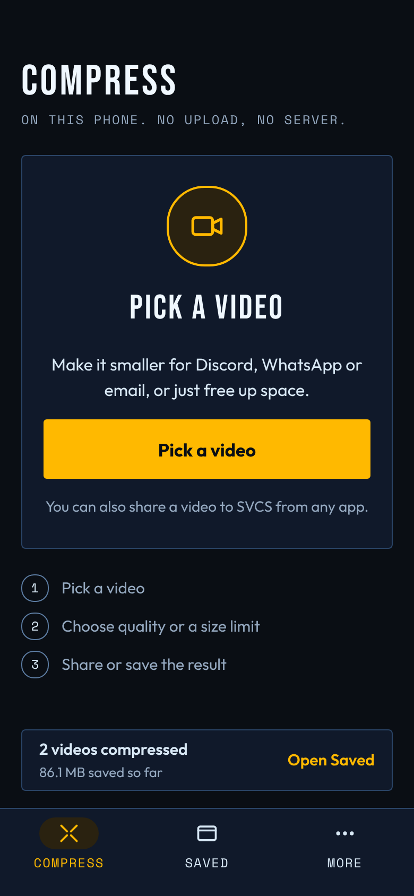
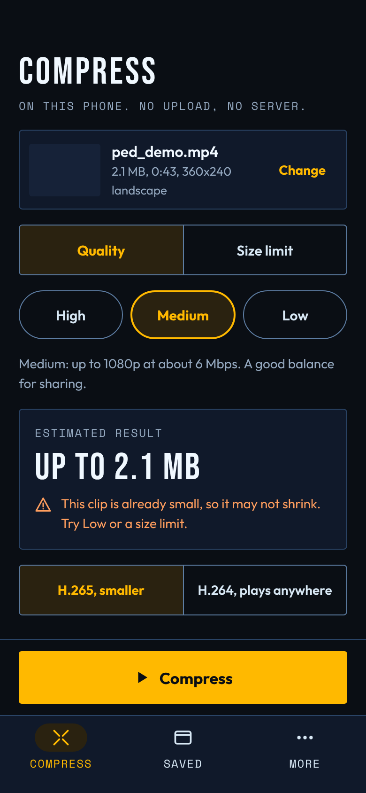
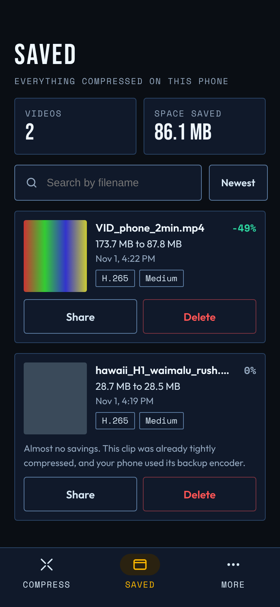
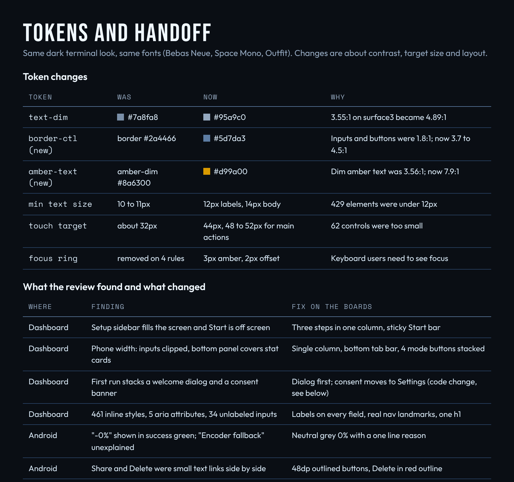

# SVCS redesign preview

These are screenshots of the proposed redesign boards (dashboard and Android app). They show the target look so the team can review it without running anything. The build instructions and the checklist of what is already implemented live in docs/REDESIGN.md and docs/DESIGN_SYSTEM.md.

## Dashboard, desktop

Three steps in one column with a sticky Start bar, an Activity panel on the right, and a theme toggle in the header.

## Dashboard, phone width

## Android: pick a video

## Android: choose and estimate

## Android: saved

## Tokens and handoff

Contrast, text size, touch target and focus ring changes, plus what the review found.

